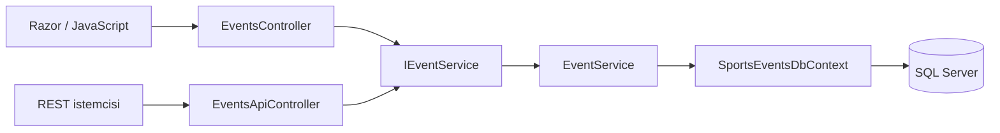
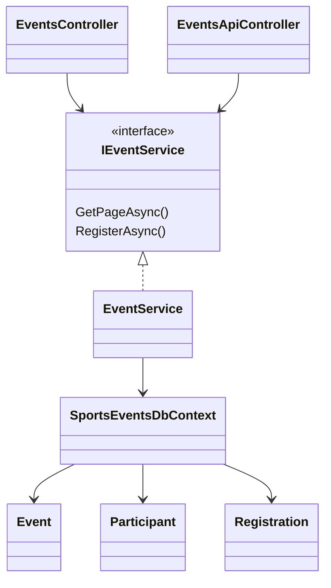
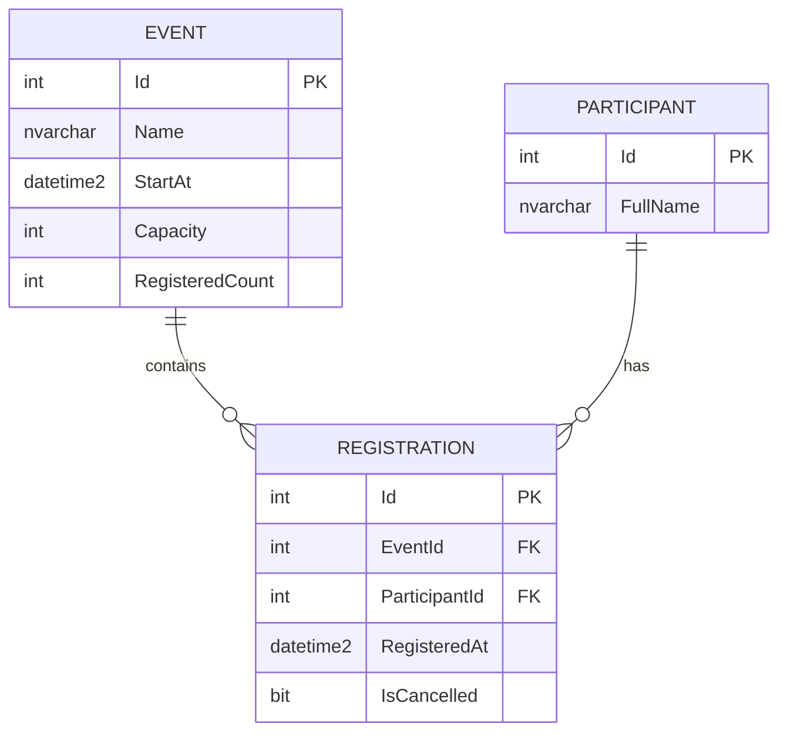

# İş analizi ve mimari

## Kapsam

Aktör: etkinlik kayıt görevlisi. Görevli tarih aralığında etkinlikleri görür, katılımcıyı seçer ve kontenjan uygunsa kayıt yapar. Salt okunur REST tüketicisi etkinlikleri JSON olarak listeler. Kimlik doğrulama, etkinlik/katılımcı yönetimi, iptal, ödeme ve bildirim bu ilk taslağın dışındadır.

| Hikâye | Kabul koşulu |
|---|---|
| US-01: Tarihe göre etkinlik ararım. | Başlangıç/bitiş günleri dahil filtrelenir; ters aralık 400 üretir; sayfada en çok 20 etkinlik bulunur. |
| US-02: Katılımcıyı etkinliğe kaydederim. | Geçerli kimliklerle boş kontenjana tek kayıt eklenir; sayaç bir artar; başarılı POST listeye yönlendirir. |
| US-03: Hatalı kaydı anlayabilirim. | Olmayan kimlik, mükerrer kayıt ve dolu kontenjan kayıt üretmez; kullanıcı hata görür. Mükerrer ve dolu birlikteyse mevcut akış önce doluluğu bildirir. |
| US-04: Kontenjan aşılmaz. | Son boş yere iki eşzamanlı istekten yalnız biri başarılı olur; başarısız INSERT sayaç artışını rollback eder. |
| US-05: Entegrasyonda etkinlikleri okurum. | GET /api/events?from=2026-11-16&to=2026-11-17&page=1 sayfa, devam bilgisi ve etkinlikleri döner; katılımcı listesi dönmez. |

## İş kuralları

- BR-01: Capacity > 0 ve 0 <= RegisteredCount <= Capacity; SQL CHECK ile korunur.
- BR-02: EventId ve ParticipantId mevcut olmalı; SQL FK ile korunur.
- BR-03: Bir etkinlik/katılımcı çifti yalnız bir kez bulunabilir; UNIQUE iptal edilmiş kayıtları da kapsar. Yeniden kayıt henüz desteklenmez.
- BR-04: Kontenjan artışı ve kayıt ekleme tek transaction'dır; servis dışındaki doğrudan SQL yazımları sayacı bozabilir.
- BR-05: Tarih filtresi başlangıç dahil, bitişten sonraki gün hariçtir; tarih kolonuna fonksiyon uygulanmaz.
- BR-06: RegisteredAt UTC tutulur. StartAt şimdilik saat dilimsiz yerel etkinlik zamanıdır; çok bölgeli kullanımda DateTimeOffset kararı gerekir.
- BR-07: İstemci doğrulaması kolaylık sağlar; sunucu ModelState ve veritabanı kısıtları esastır.

## Mantıksal katmanlar

Bu tek projeli bir taslaktır. Klasörler sorumlulukları ayırır, derleme düzeyinde bağımlılık kısıtı sağlamaz. EF DbContext veri erişimi ve unit of work görevini üstlenir; ayrıca genel repository katmanı eklenmedi.

Registration üzerindeki (EventId, ParticipantId) birleşik benzersizlik kısıtı ER diyagramına ek bir bütünlük kuralıdır.

## Güvenlik ve yaşam döngüsü

Tehditler: sahte form isteği → antiforgery; HTML enjeksiyonu → Razor encoding ve CSP; SQL injection → EF parametrelemesi; fazla alan bağlama → dar giriş modeli; yarış durumu → transaction ve constraint. Sırları kaynak koda yazma; yerelde user-secrets, sunucuda korumalı ortam ayarı kullan. Loglara bağlantı dizesi ve katılımcı bilgisi yazma.

Akış: gereksinim/kabul koşulları → tasarım/tehdit incelemesi → küçük değişiklik → inceleme → otomatik kontroller → test ortamı SQL/HTTP testleri → paket → yayın → izleme → geri bildirim. Üretim öncesi kimlik doğrulama, rol ve nesne bazlı yetki, denetim izi, hız sınırlama, bağımlılık taraması ve kişisel veri saklama kararları tamamlanmalı.

Açık sorular: İptal sonrası tekrar kayıt olacak mı? Başlamış etkinliğe kayıt serbest mi? Katılımcıyı görevli mi yoksa kullanıcının kendisi mi seçer? Zaman dilimi ve kişisel veri saklama süresi nedir? Bunlar taslakta uygulanmış kurallar olarak varsayılmadı.
